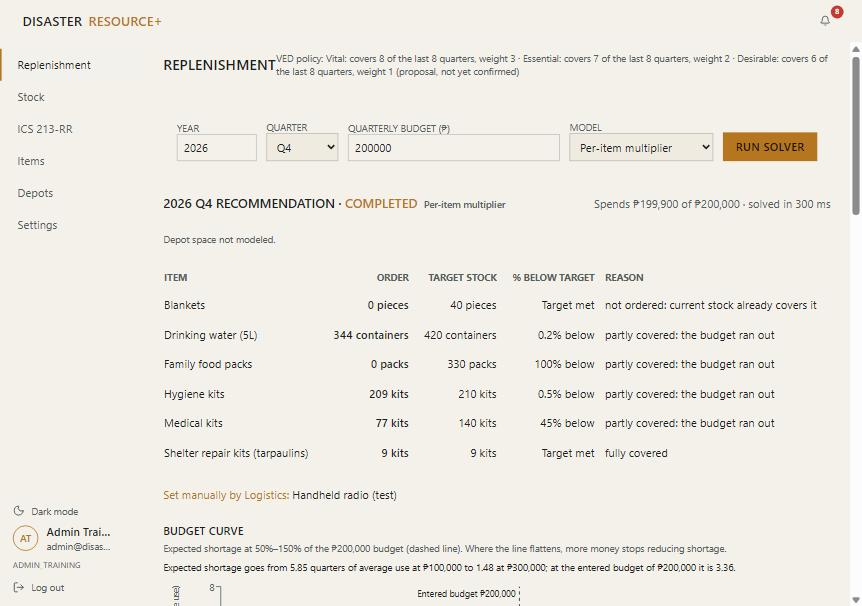
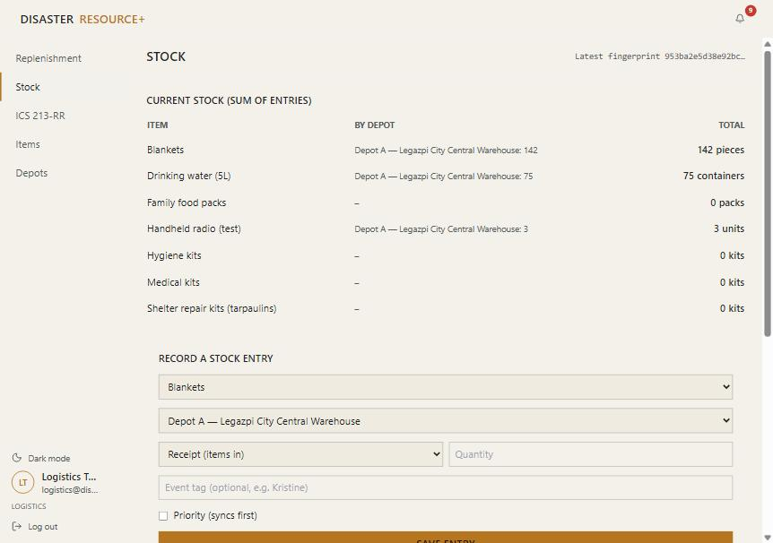
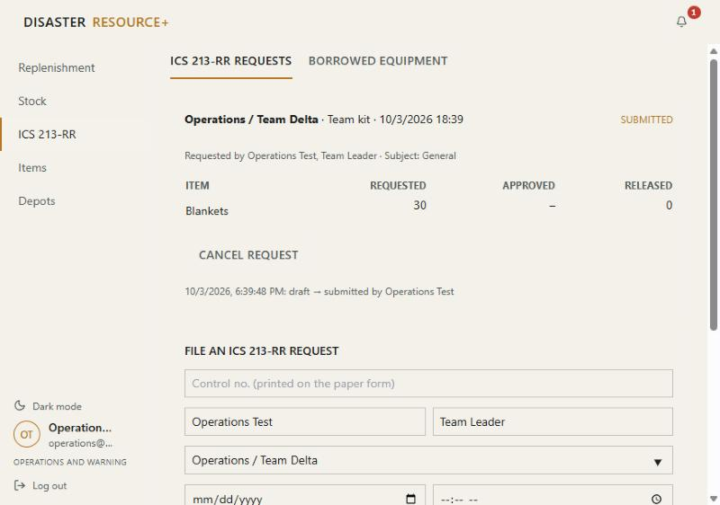
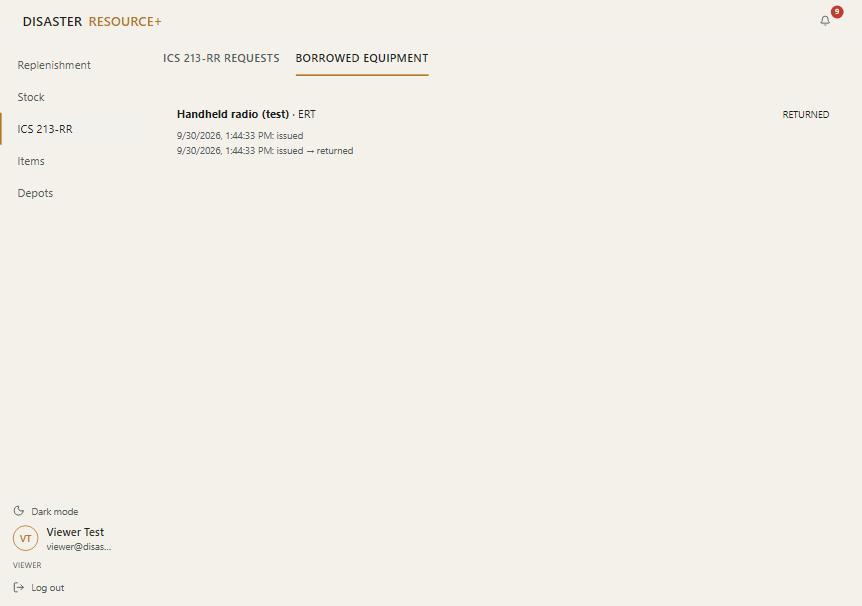

# What each account can see and do (2026-10-03)

The roles follow the office structure confirmed in the 2026-09-03 requirements interview: Research and Planning, Operations and Warning, Administration and Training and Administrative, with Logistics as a section under Administration and Training. The Admin is the Head of Office (Department Head). ERT and the other response teams are teams inside Operations, and the Assistant Department Head is a position title, so neither is a role.

Every account opens every page (Replenishment, Stock, ICS 213-RR, Items, Depots) read-only. Only the Admin sees Settings. The table shows what each account can **do** beyond reading. It follows the routes' role gates (`routes/web.php`, `routes/api.php`), which `RoleGatingTest` and `EvaluationTest` check for each role. The screenshots were taken signed in as the seeded test accounts.

| Account | Run solver, approve plan | Encode history | Export report | Record stock | Resolve conflicts | File ICS 213-RR | Approve ICS | Release, lend, return | See borrower names | Edit items and depots | Users and settings |
|---|---|---|---|---|---|---|---|---|---|---|---|
| **Admin** (Head of Office) | ✓ | ✓ | ✓ | ✓ | ✓ | ✓ | ✓ | ✓ | ✓ | ✓ | ✓ |
| **Logistics** | | ✓ | ✓ | ✓ | ✓ | ✓ | | ✓ | ✓ | | |
| **Operations and Warning** | | | | | | ✓ | | | | | |
| **Research and Planning** | | | ✓ | | | | | | | | |
| **Administration and Training** | | | | | | | | | | ✓ | |
| **Administrative** | | | | | | | | | | | |
| **Viewer** (unassigned) | | | | | | | | | | | |

*Admin: runs the solver and approves or rejects; the only sidebar with Settings.*

*Logistics: records stock entries (offline too); no Settings.*

*Operations and Warning (its ERT teams file through it): files requests; no approve or release controls.*

*Viewer: read-only, and borrower names are hidden (only the Admin and Logistics see them).*

The Admin can also approve or reject a request they filed themselves.
