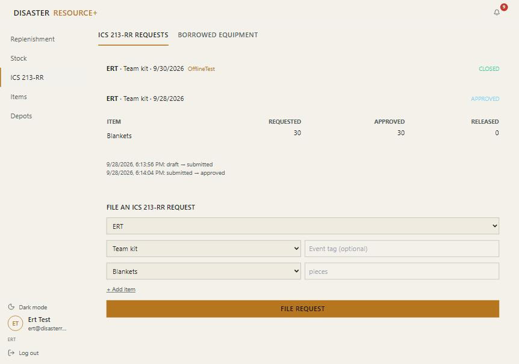

# What each account can see and do (2026-09-30)

Every account opens every page (Replenishment, Stock, ICS 213-RR, Items, Depots) read-only. Only the Admin sees Settings. The table shows what each account can **do** beyond reading. It was taken from the live pages' permission flags, signed in as each seeded test account.

| Account | Run solver, approve plan | Encode history | Export report | Record stock | Resolve conflicts | File ICS 213-RR | Approve ICS | Release, lend, return | See borrower names | Edit items and depots | Users and settings |
|---|---|---|---|---|---|---|---|---|---|---|---|
| **Admin** (Head of Office) | ✓ | ✓ | ✓ | ✓ | ✓ | ✓ | ✓ | ✓ | ✓ | ✓ | ✓ |
| **Logistics** | | ✓ | ✓ | ✓ | ✓ | ✓ | | ✓ | ✓ | | |
| **ERT** | | | | | | ✓ | | | | | |
| **Operations** | | | | | | ✓ | | | | | |
| **Incident Management** | | | | | | ✓ | | | | | |
| **Research and Planning** | | | ✓ | | | | | | | | |
| **Admin and Training** | | | | | | | | | | ✓ | |
| **Viewer** (unassigned) | | | | | | | | | | | |

*Admin: runs the solver and approves or rejects; the only sidebar with Settings.*

*Logistics: records stock entries (offline too); no Settings.*

*ERT (also Operations and Incident Management): files requests; no approve or release controls.*

*Viewer: read-only, and borrower names are hidden (only the Admin and Logistics see them).*

The Admin can also approve or reject a request they filed themselves.
